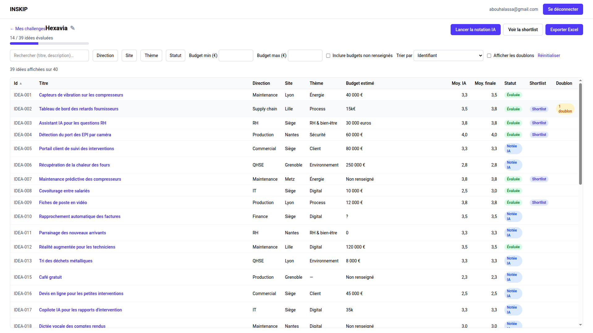
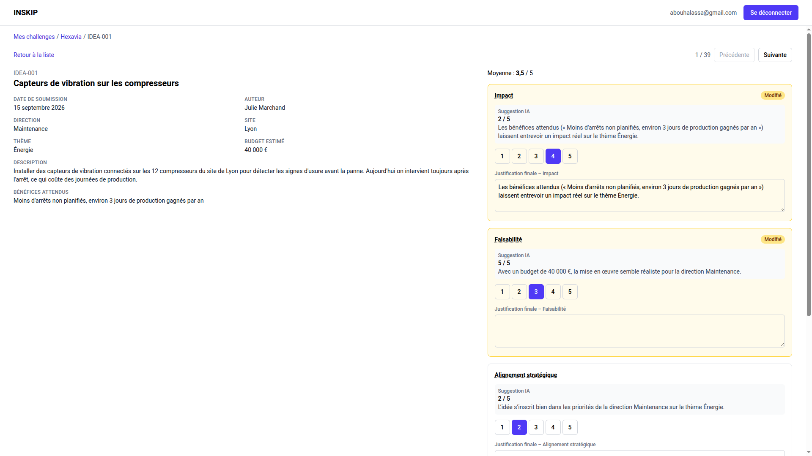
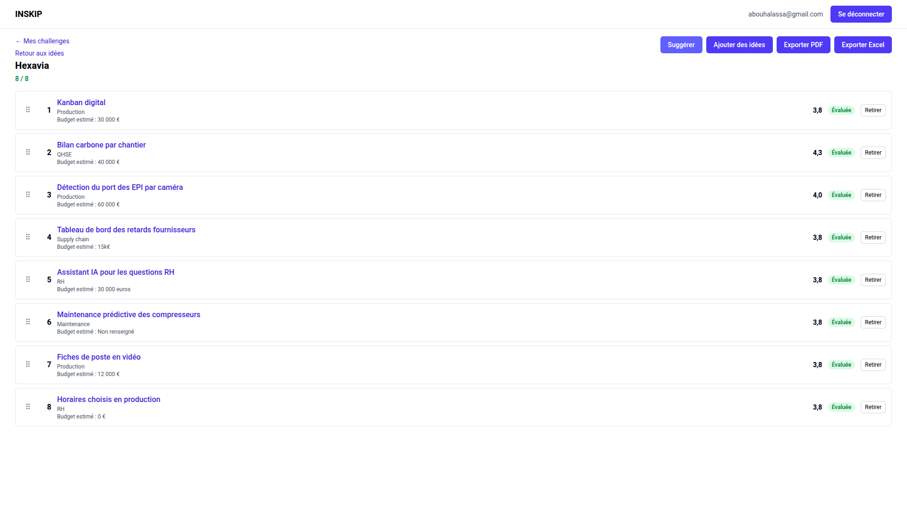

# INSKIP

Outil de revue des idées d'un challenge d'innovation interne : import du fichier du formulaire, notation sur une grille fixe avec une première passe IA, détection des doublons, shortlist et export PDF pour le jury.

## Aperçu

**Application :** https://inskip-web.vercel.app

**Github :** https://github.com/i-Glow/inskip-web

<!-- À compléter : 2 ou 3 captures, par exemple -->

| Liste des idées                                     | Fiche et notation                             | Shortlist                                    |
| --------------------------------------------------- | --------------------------------------------- | -------------------------------------------- |
|  |  |  |

## Lancer l'outil

Prérequis : Node 22 et un projet Supabase (URL + clé publique).

```bash
git clone https://github.com/i-Glow/inskip-web.git
cd inskip-web
npm install
cp .env.example .env.local   # renseigner VITE_SUPABASE_URL et VITE_SUPABASE_ANON_KEY
npm run dev                  # http://localhost:5173
```

Base de données neuve : `npx supabase link --project-ref <ref>` puis `npx supabase db push` applique le schéma (tables, RLS, fonction de doublons), et `npx supabase functions deploy score-idea` déploie la notation IA simulée. Fichier d'essai : `test/fixtures/idees_hexavia.csv` (40 idées).

Autres commandes : `npm test` (tests unitaires), `npm run lint`, `npm run build`, `npm run db:types` (régénère les types après une migration).

## 1. Cadrage

**Le besoin.** Camille accompagne Hexavia (groupe industriel, 4 000 salariés) sur son challenge d'innovation interne. Les salariés ont déposé 40 idées via un formulaire exporté en CSV. Aujourd'hui elle les relit à la main dans Excel : c'est lent, la notation manque de cohérence, des doublons passent, et elle doit refaire une shortlist présentable pour le jury. Le jury se réunit dans 10 jours, il faut donc un outil utilisable en 5 jours environ, et réutilisable pour d'autres clients.

**Utilisateurs.** Camille, consultante non technique, seule utilisatrice en V1. Le jury ne reçoit que le PDF.

**Mes hypothèses.**

- Les autres clients exporteront le même format de colonnes (sinon, mapping de colonnes en V2).
- Une grille fixe de 4 critères notés de 1 à 5 avec le même poids (impact, faisabilité, alignement, innovation) suffit.
- Les doublons qui comptent sont les dépôts identiques (titre + description) ; les reformulations sont repérées par Camille.
- L'IA propose, Camille décide : le PDF ne contient que les notes finales, sans mention de l'IA.
- Les idées contiennent des données sensibles : une connexion (lien magique) est nécessaire pour les protéger, et chaque utilisateur ne voit que ses propres challenges.
- Pas d'appel à un vrai modèle d'IA en V1 : les suggestions sont simulées, mais l'architecture (Edge Function) est prête pour le branchement.
<!-- À compléter : ajoute ou retire tes propres hypothèses -->

**Dans la V1.** Connexion par lien magique ; création d'un challenge par simple import CSV/XLSX avec normalisation des budgets ; liste filtrable et triable (direction, site, thème, statut, budget, recherche) ; fiche idée avec notation, autosave et navigation précédente/suivante ; notation IA en masse ; doublons exacts ; shortlist ordonnée par glisser-déposer ; export PDF et Excel.

**Ce qui attendra.** Appel à un vrai modèle d'IA, doublons proches avec un calcul vecteur ou détéction par IA, critères ou poids configurables, mapping de colonnes pour d'autres formulaires si différent, plusieurs utilisateurs pour un projet (projet partagé), personnalisation graphique de l'export.

## 2. Conception

**Architecture.**

```
Navigateur (React SPA, Vercel)
  ├─ Supabase Auth ........ lien magique, session persistée
  ├─ Supabase Postgres .... tables + RLS, accès direct depuis le front
  └─ Edge Function score-idea (Deno) ... notation IA (mock en V1)
```

Le parsing du fichier, les filtres, les tris et les exports se font côté navigateur ; le serveur ne garde que les données et la notation.

| Choix                                     | Raison                                                                                                                                                 |
| ----------------------------------------- | ------------------------------------------------------------------------------------------------------------------------------------------------------ |
| React + TypeScript + Vite                 | Écosystème standard, typage de bout en bout avec les types générés de Supabase, build rapide.                                                          |
| Supabase (Postgres, Auth, Edge Functions) | Base relationnelle, authentification par lien magique et fonctions serveur dans un seul service hébergé dans l'UE (Paris) ; aucun backend à maintenir. |
| Row Level Security sur chaque table       | Chaque utilisateur ne voit que ses challenges, même en appelant l'API directement ; le front n'a besoin d'aucune clé secrète.                          |
| Edge Function pour l'IA, même en mock     | L'architecture finale est en place : passer au vrai modèle (`AI_MODE=live`) ne changera que l'appel au fournisseur, la clé restera côté serveur.       |
| Vercel + GitHub Actions                   | Hébergement statique simple ; la CI est le seul chemin de déploiement.                                                                                 |

**Modèle de données** (détail dans [docs/architecture.md](docs/architecture.md)).

- `challenges` : titre (nom du fichier par défaut), fichier source, propriétaire.
- `ideas` : colonnes du formulaire (id externe, date de dépôt brute et parsée, auteur, direction, site, thème, titre, description, bénéfices, budget brut et en €), `content_key` généré, statut (`new`, `ai_scored`, `reviewed`, `duplicate`), `duplicate_of`, shortlist et rang.
- `scores` : une ligne par idée et par critère, avec la suggestion IA (note, justification, modèle) et la note finale de Camille.
- Vue `idea_averages` : moyennes IA et finale par idée, la note finale retombant sur la suggestion IA si elle est vide.

## 3. Construction avec l'IA

**Assistant utilisé.** Claude Code (Claude Opus 5.5), avec le skill _brainz_ : Opus planifie et relit, des sous-agents moins chers (Sonnet) écrivent le code et les tests, et chaque étape est validée par commande (tests, build, lint), Claude Haiku recherche des fichiers pour contexte. Le PRD a été rédigé en amont avec Claude (claude.ai) à partir du mail de Camille et du fichier d'export, puis découpé en une spec par fonctionnalité (`docs/0N-*.md`) qui servait de brief à Claude Code.

**Mes prompts les plus utiles.**

<!-- À ajuster : garde ceux qui t'ont le plus servi -->

1. _« [mail de Camille collé tel quel] build me a PRD.MD for a V1. Stack: React, Typescript, Supabase DB and edge functions, vercel for deployment. […] we call db directly from the front, and we call an edge function to generate AI responses since we have to use an api with a secret key. we're going to use magic links for auth »_ : le besoin brut de la cliente plus mes choix techniques imposés ; une première version complète du PRD (objectifs, hors périmètre, modèle de données, RLS, Edge Functions, jalons, questions pour Camille), que je n'avais plus qu'à recadrer.
2. _« Let's keep the challenge creation simple and just by uploading a file […] criteria scores don't have weight […] we are going to fake the data for AI scoring […] keep duplicate detection for exact text matching only […] Update the data model based on the CSV file attached »_ : réduire la V1 à l'essentiel point par point et caler le modèle de données sur le vrai export. L'analyse du CSV a fait ressortir les dates au format mixte, les budgets en texte libre (`15k€`, `?`…) et les doublons « proches » que la règle exacte ne verra pas, tous intégrés au PRD puis découpés en une spec par fonctionnalité.
3. _« Initialize a project, following the folder structure in the PRD file, don't implement anything yet »_ : un squelette complet et vide, conforme au PRD, avant d'écrire la moindre logique.
4. _« We're going to include unit tests to validate each feature we build, choose a testing library where you separate tests under a /test folder »_ : une convention fixée une fois (un dossier par fonctionnalité, Supabase simulé), réutilisée ensuite à chaque fonctionnalité.
5. _« Create a public GitHub repo… build a GitHub CI pipeline that tests then deploys to Vercel with Supabase db and edge functions… ask me for the actions I need to do on my side »_ : l'assistant fait tout ce qu'il peut, et me laisse les secrets (jetons, mot de passe de la base).

**Un moment où l'IA s'est trompée.** La plupart des erreurs de l'IA ont porté sur l'interface, et je les ai vues en utilisant les écrans, pas dans les tests. Par exemple, la première version des listes déroulantes de filtres ne se fermait pas en cliquant ailleurs, et le filtre par plage de score était peu utile ; j'ai demandé de corriger la fermeture et de remplacer ce filtre par un tri « Trier par ».

<!-- À compléter si tu as un autre exemple plus parlant -->

## 4. Fiabilisation

**Tests unitaires : 202 tests** (Vitest + React Testing Library + jsdom), rangés dans `test/` avec un dossier par fonctionnalité. Supabase est toujours simulé : les tests ne dépendent ni du réseau ni d'un compte.

Comme le code est écrit par l'IA, je lui ai fait écrire des tests qui couvrent la quasi-totalité des specs, à partir des critères d'acceptation de chaque fichier `docs/0N-*.md`. Ce sont des tests unitaires, mais ils vérifient le comportement attendu par la spec (ce que Camille voit et obtient), pas seulement le détail de l'implémentation : c'est mon filet de sécurité pour relire du code que je n'ai pas tapé.

| Dossier                  | Tests | Ce qui est vérifié, et pourquoi                                                                                                                                                                                                      |
| ------------------------ | ----- | ------------------------------------------------------------------------------------------------------------------------------------------------------------------------------------------------------------------------------------ |
| `f1-auth`                | 21    | Redirections des pages protégées, envoi du lien magique, erreurs de lien expiré : sans ça, Camille ne peut pas entrer ou voit les données d'un autre.                                                                                |
| `f2-challenge-upload`    | 47    | Parsing du vrai fichier Hexavia (40 lignes), dates `JJ/MM/AAAA`, tous les formats de budget (`15k€`, `30 000 euros`, `?`…), colonnes manquantes, aucune création si l'import échoue : c'est la porte d'entrée de toutes les données. |
| `f3-ideas-list`          | 47    | Chaque filtre, « Non renseigné », recherche sans accents, tri du budget (inconnus en dernier), filtres dans l'URL, 200 idées filtrées et triées en moins de 50 ms.                                                                   |
| `f4-idea-detail-scoring` | 33    | Pré-remplissage depuis l'IA, autosave groupée après 800 ms, validation, navigation précédente/suivante qui respecte les filtres, règles de la shortlist.                                                                             |
| `f5-ai-scoring-mock`     | 23    | Notes déterministes et entre 1 et 5, ajustements selon les données, concurrence limitée à 3, reprise d'un échec : la notation doit être stable pour les démos.                                                                       |
| `f6-duplicate-detection` | 5     | Bandeau doublon et « Ce n'est pas un doublon » (retour au bon statut).                                                                                                                                                               |
| `f7-shortlist-export`    | 26    | Contenu du PDF (ordre, notes finales, **aucune mention de l'IA**), classeur Excel (doublons exclus), compteur 7 / 8, suggestion du top 8.                                                                                            |

**Vérifié sur la vraie base**, dans une transaction annulée : la RLS (un second utilisateur voit 0 idée, un visiteur non connecté n'a aucun droit) et la détection de doublons (IDEA-014 rattachée à IDEA-002). La fonction `score-idea` déployée refuse les appels sans session valide.

**La CI** ([.github/workflows/ci.yml](.github/workflows/ci.yml)), à chaque push :

1. `test` : lint, tests unitaires, build (qui vérifie aussi les types des tests).
2. Sur `master` uniquement : `deploy-supabase` applique les nouvelles migrations puis déploie `score-idea`.
3. `deploy-vercel` : en production sur `master`, une fois la base à jour ; sur les autres branches, un déploiement de preview qui ne touche jamais la base.

Le déploiement automatique de Vercel est désactivé : la CI est le seul chemin vers la production, donc rien n'est mis en ligne sans tests verts.

## 5. Livraison

**Configuration.**

- Front : `VITE_SUPABASE_URL` et `VITE_SUPABASE_ANON_KEY` (`.env.local` en local, variables du projet Vercel en ligne). Ce sont des valeurs publiques, la sécurité repose sur la RLS.
- Edge Function : `AI_MODE` (`mock` par défaut, rien à configurer en V1).
- Supabase Auth : URL du site et URL de redirection `https://inskip-web.vercel.app/auth/callback`.
- CI : secrets GitHub `SUPABASE_ACCESS_TOKEN`, `SUPABASE_DB_PASSWORD`, `VERCEL_TOKEN` ; variables `SUPABASE_PROJECT_REF`, `VERCEL_ORG_ID`, `VERCEL_PROJECT_ID`.

**Ce qui manque avant de le confier à Camille.**

- Un test de bout en bout avec un vrai compte sur l'URL de production : connexion par lien magique, import du fichier Hexavia, notation IA en masse, export PDF.
- Un SMTP personnalisé dans Supabase : l'envoi d'e-mails par défaut est limité et peut finir en spam.
- Une séance avec Camille sur son vrai fichier (jour 5 du plan) et la réponse aux questions de la section 7, en particulier le format attendu pour le document du jury.
<!-- À compléter : ce que tu as constaté en testant toi-même -->

## 6. Journal

| Heure | Étape                                                                                                            |
| ----- | ---------------------------------------------------------------------------------------------------------------- |
| 09:08 | Démarrage, lecture du PRD et des specs                                                                           |
| 09:58 | Squelette du projet selon la structure du PRD                                                                    |
| 10:19 | Projet Supabase (Paris) créé et connecté, authentification par lien magique                                      |
| 10:33 | Schéma, RLS et import de challenge ; mise en place des tests unitaires sous `test/`                              |
| 11:17 | Liste des idées, fiche et notation, notation IA simulée (Edge Function déployée), doublons, shortlist et exports |
| 11:33 | Budget estimé partout, ajout d'idées depuis la shortlist, colonne titre élargie, specs mises à jour              |
| 11:41 | Dépôt GitHub public, projet Vercel, pipeline CI                                                                  |
| 11:52 | Deux corrections de la CI, premier déploiement complet en production                                             |
| 12:09 | Mise en page pleine largeur, tableaux défilant dans l'écran, liens de retour, curseurs                           |
| 12:30 | Correction de .env.example et rédaction de README.MD                                                             |
| 12:55 | Dernière modification et push                                                                                    |

## 7. Suite et questions pour Camille

**Avec une journée de plus.**

- Faire le test de bout en bout avec Camille sur le fichier Hexavia et corriger ce qu'elle remonte.
- Brancher un vrai modèle d'IA derrière `AI_MODE=live` (prompt déjà esquissé, clé dans les secrets Supabase), avec les textes anonymisés.
- Ajouter un test end-to-end automatisé (Playwright) du parcours import → notation → export dans la CI.
- Configurer un SMTP personnalisé.
- Repérer les doublons proches (par exemple IDEA-001 / IDEA-007 et IDEA-003 / IDEA-019 dans le fichier Hexavia), soit en les faisant comparer par l'IA, soit par similarité vectorielle (embeddings des textes stockés avec pgvector).

**Questions pour Camille.**

1. Quel format attend-elle pour le document remis au jury (contenu de chaque fiche, mise en page) ?
2. Les formulaires des autres clients auront-ils les mêmes colonnes ? Sinon, il faudra une étape de correspondance des colonnes.
3. Un PDF suffit-il pour la séance du jury, ou faut-il aussi des slides ?
4. La suggestion de l'IA doit-elle proposer une note pour chaque critère, ou une note globale par idée ?
